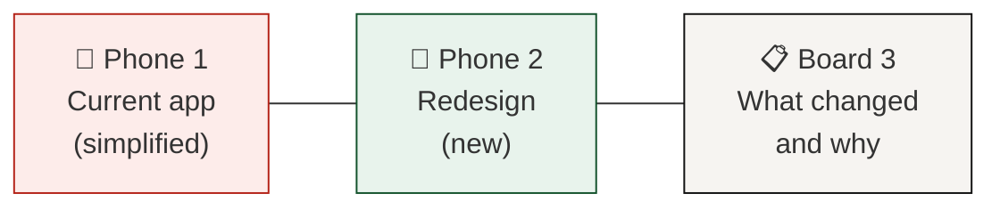
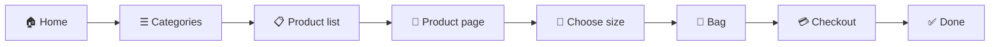
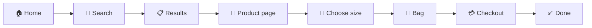
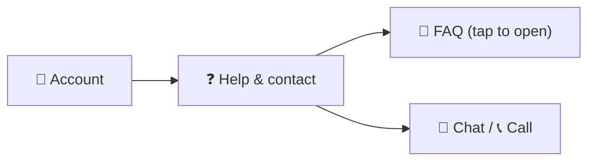
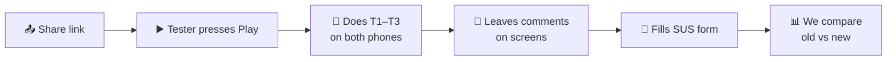

# 🛍️ Zara App Redesign: Ideas and Plan

> **Course:** Designing User Interfaces (Master BIS, VGU)
> **Type:** Student concept. Not linked to Zara or Inditex.
> **Tool:** Claude Design canvas (clickable prototype)
> **Date:** 31 October 2026

---

## 📌 1. Goal of the project

We picked an app with a poor user experience: the **Zara shopping app**. The plan has four steps:

| Step | What we do | Icon |
|---|---|---|
| 1 | Find the UI and UX problems in the current app | 🔍 |
| 2 | Redesign the main screens | ✏️ |
| 3 | Build a clickable prototype with **two phones** (old vs new) | 📱📱 |
| 4 | Share a web link and collect feedback from users | 💬 |

The prototype **does not have every feature** of the real app. It only covers the **main shopping flows**, so testers can click from screen to screen as they would in a real app.

---

## 🧭 2. The big idea: two phones side by side

Testers see **both versions on one canvas**. They can try the old app first, then the new one, and feel the difference for themselves.



| Board | Purpose | Clickable? |
|---|---|---|
| 📱 **1. Current app** | Shows the problems of today's app | ✅ Yes |
| 📱 **2. Redesign** | Shows our new solution | ✅ Yes |
| 📋 **3. What changed and why** | A table of problems, fixes and heuristics, plus the test tasks | ❌ No (read only) |

---

## 🔀 3. The main user flows

The prototype has **2 main flows** and **1 extra flow**. Together they cover **5 sections**.

### 🗺️ Sections

| # | Section | Icon |
|---|---|---|
| 1 | Home & menu | 🏠 |
| 2 | Search & list | 🔎 |
| 3 | Product page | 👕 |
| 4 | Bag & checkout | 🛒 |
| 5 | Account & help | 👤 |

### Flow 1: Menu → Product → Checkout



### Flow 2: Search → Product → Checkout



### Extra flow: Account & help



---

## ⚠️ 4. Problems and solutions, section by section

### 🏠 4.1 Home & menu

| ❌ Current app | ✅ Redesign |
|---|---|
| A large photo covers the whole screen | Clear home page with a search bar, category chips and trending products |
| A small menu icon (☰) with **no label** | **Bottom tab bar** with 5 labelled tabs: Home, Categories, Search, Bag, Account |
| The bag icon does not show how many items are inside | The tab says **“Bag (2)”** |

**Heuristic:** #6 Recognition rather than recall

### 🔎 4.2 Search & list

| ❌ Current app | ✅ Redesign |
|---|---|
| Search is **hidden inside the menu** | Search is **one tap away** (tab + home search bar) |
| An empty search box with no help | **Popular searches** and **Shop by category** buttons |
| Product names and prices in tiny grey text | Clear names and **bold prices** |
| “Filters” is small text that does nothing | Working **price filter** and **sort by price** |

**Heuristic:** #7 Flexibility and efficiency of use

### 👕 4.3 Product page

| ❌ Current app | ✅ Redesign |
|---|---|
| Sizes appear only **after tapping “Add”**, in a pop-up | **All sizes are visible** on the page |
| No size guide | A **“Size guide”** link that opens a size table |
| A small “1 item added” message that is easy to miss | A green message: **“✓ Added to your bag”** with a **View bag** button |
| You can try to add without a size | The **“Add to bag” button stays off** until you choose a size |
| No favourites button | A ♡ button to save the item |

**Heuristic:** #5 Error prevention, #1 Visibility of system status

### 🛒 4.4 Bag & checkout

| ❌ Current app | ✅ Redesign |
|---|---|
| A **login wall** before checkout | **Guest checkout** by default (login is optional) |
| “Continue as guest” is a tiny grey link | A clear note: “No account needed” |
| **4 separate screens** (Bag → Login → Shipping → Payment) | **One page** with **3 clear steps**: Delivery → Payment → Review |
| “Shipping calculated later” | A **full price summary** (subtotal, delivery, total) |
| No way to remove an item | A **Remove** button on each item |

**Heuristic:** #1 Visibility of system status, #3 User control and freedom

### 👤 4.5 Account & help

| ❌ Current app | ✅ Redesign |
|---|---|
| Help is a **long page of small text** | **Chat** 💬 and **Call** 📞 buttons at the top |
| No search, no quick answers | Short **FAQ answers that open on tap** (+ / −) |
| The account page is only a login form | A friendly account page: “Hello, guest”, orders, favourites, addresses, help |

**Heuristic:** #10 Help and documentation

### 🔤 4.6 Readability (all screens)

| ❌ Current app | ✅ Redesign |
|---|---|
| 8–11 px text | 13–17 px text |
| ALL CAPITALS everywhere | Normal sentence case |
| Light grey text (low contrast) | Dark text with strong contrast (WCAG AA, 4.5 : 1) |
| Small tap areas (about 30 px) | Tap areas of **44 px or more** |

**Heuristic:** #8 Aesthetic and minimalist design + WCAG accessibility

---

## 📊 5. Fewer taps in the new design

These numbers are the **taps needed in our prototype** to finish each flow, from the home screen to “Order placed”.

```mermaid
xychart-beta
    title "Taps needed to finish each flow"
    x-axis ["Flow 1 (Menu)", "Flow 2 (Search)"]
    y-axis "Number of taps" 0 --> 12
    bar [10, 11]
    bar [8, 8]
```



| Flow | 📱 Current | 📱 Redesign | Saved |
|---|---|---|---|
| Flow 1: Menu → Checkout | 10 taps | 8 taps | **−2 (−20%)** |
| Flow 2: Search → Checkout | 11 taps (+ typing) | 8 taps (no typing needed) | **−3 (−27%)** |

> 💡 The redesign also removes the **login screen** and the **separate size pop-up**, which are the two places where users are most likely to get stuck.

---

## 🎨 6. Design system of the redesign

The design system we selected in Claude is still an **empty template**, so the redesign uses a simple black-and-white fashion style. Later, we can save these values into the Claude Design System.

### 🎨 Colours

| Token | Hex | Use |
|---|---|---|
| `ink` | `#111111` | Main text, primary buttons, active tab |
| `background` | `#FFFFFF` | Screen background |
| `surface` | `#F6F4F1` | Cards, search bar, summaries |
| `border` | `#E6E2DC` | Lines between rows |
| `muted` | `#5C5C5C` | Secondary text (still passes contrast) |
| `inactive` | `#6B6B6B` | Inactive tabs |
| `success-bg` / `success` | `#E8F3EC` / `#14532D` | “Added to bag”, order done |
| `disabled` | `#8A8A8A` | “Add to bag” before a size is chosen |

### 🔤 Typography

| Style | Font | Size | Use |
|---|---|---|---|
| Brand / display | Bodoni Moda | 28–34 px | Logo text, hero title |
| Heading 1 | Inter, semibold | 22–26 px | Screen titles |
| Heading 2 | Inter, semibold | 15–18 px | Section titles |
| Body | Inter, regular | 14–15 px | Normal text |
| Small | Inter | 12–13 px | Tab labels, notes |

### 📐 Spacing and shape

| Item | Value |
|---|---|
| Screen side margin | 20 px |
| Gap between items | 8 / 12 / 16 / 20 px |
| Button height | 44–54 px |
| Button corner | Fully round (pill) |
| Card corner | 8–12 px |
| Phone frame | 390 × 844 px |

### 🧩 Main components

| Component | Where it is used |
|---|---|
| 🔘 Primary button (black pill) | Shop now, Add to bag, Go to checkout, Place order |
| ⚪ Secondary button (outline pill) | Log in, Call us |
| 🏷️ Chip | Categories, popular searches, filters |
| 📏 Size selector (5 boxes) | Product page |
| 🃏 Product card | Home, list, results |
| 🔘 Radio card | Delivery and payment options |
| 📊 Step bar (1-2-3) | Checkout |
| ✅ Success message | Added to bag, order done |
| ➕ Accordion | FAQ on the help page |
| 🧭 Bottom tab bar | All main screens |

### 🖼️ Icons

Simple **line icons** (stroke 1.8 px): home, categories (grid), search, bag, user, back, heart, chat, phone, check.

---

## 🧪 7. Usability testing plan

### 👥 Who

- **5–8 participants**, aged 18–40, who shop for clothes online
- Each person tests **both versions**. Half start with the old app and half start with the new one, so the order does not affect the results.

### 📝 Tasks

| Task | Description |
|---|---|
| **T1** | Open Categories, find a blazer, choose size M and place the order. |
| **T2** | Search for “jeans”, open the product, add it and go to checkout. |
| **T3** | Find out how to return an item. |

### 📏 What we measure

| Metric | How | Icon |
|---|---|---|
| Task success | Did the user finish? (yes / no) | ✅ |
| Time on task | Seconds per task | ⏱️ |
| Number of taps | Count the taps | 👆 |
| Errors | Wrong taps, getting lost | ❌ |
| Satisfaction | **SUS** questionnaire (10 questions, score 0–100) | 😊 |
| Comments | Open feedback on the canvas | 💬 |

### 🔁 Process



---

## 🌐 8. Exporting the web link and collecting feedback

1. Open the **Claude Design canvas**: *Zara Redesign Prototype*.
2. Click **Share** and choose who can open it (for example, anyone with the link).
3. Send the link to the testers.
4. Testers press **▶️ Play** on Phone 1 and Phone 2.
5. Testers add **comments** directly on any screen.
6. We read all the comments and update the design.

> ⚠️ The canvas is **private** until you share it. Testers cannot open the link before that.

---

## 📁 9. Files and repository

**Local folder:** `C:\Thạc Sĩ\Designing_User_Interfaces\Zara_UI_UX_System_Design`
**GitHub:** <https://github.com/linhkle1706/Zara-UI-UX-Design-Interface> (planned branch: `assistant/zara-prototype`, waiting for approval)

```
Zara_UI_UX_System_Design/
├── README.md                    ← short guide
├── Zara_Redesign_Ideas.md       ← this document
└── project/
    ├── canvas.json              ← canvas layout
    ├── Current.dc.html          ← Phone 1: current app
    ├── Main.dc.html             ← Phone 2: redesign
    └── Differences.dc.html      ← Board 3: what changed and why
```

---

## 🚀 10. Next steps

| # | Step | Status |
|---|---|---|
| 1 | Build the two-phone prototype | ✅ Done |
| 2 | Write the “What changed and why” board | ✅ Done |
| 3 | Share the link and run tests with 5–8 users | ⏳ To do |
| 4 | Collect SUS scores and comments | ⏳ To do |
| 5 | Improve the redesign based on the feedback | ⏳ To do |
| 6 | Save colours, fonts and components into the Claude Design System | ⏳ To do |
| 7 | Push the files to GitHub (feature branch) | ⏳ Waiting for approval |
| 8 | Write the final report with charts | ⏳ To do |

---

*Note: Product photos, prices, address and order number in the prototype are placeholders. The Zara name is used only to identify the app being studied.*
